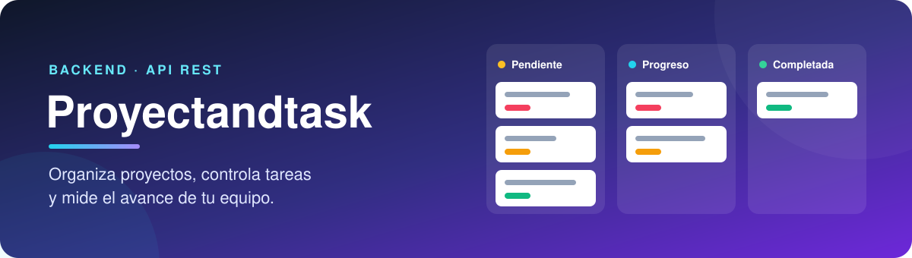
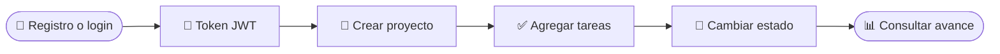
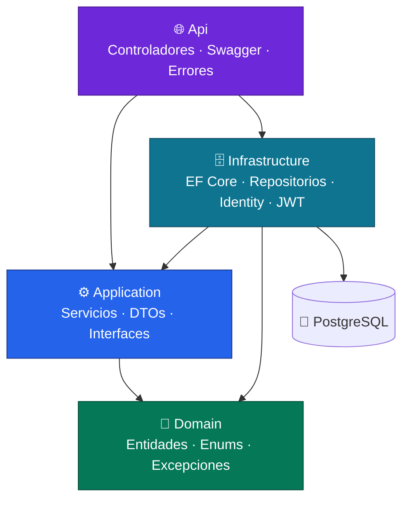
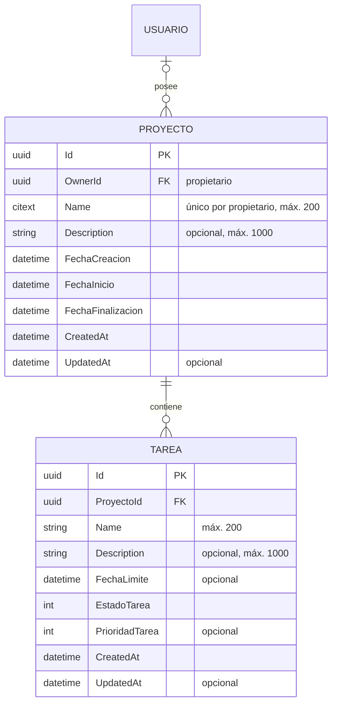
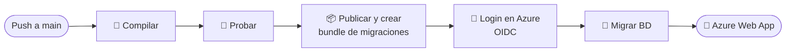

<div align="center">



<br><br>


[](https://github.com/ChrisOnfroy/ProyectoAndTarea.Backend/actions/workflows/main_proyectandtask.yml)

[**✨ Funciones**](#-qué-hacemos) · [**🧰 Tecnologías**](#-tecnologías) · [**🏛️ Arquitectura**](#️-arquitectura) · [**🚀 Instalación**](#-puesta-en-marcha) · [**📡 API**](#-referencia-de-la-api) · [**🧪 Pruebas**](#-pruebas) · [**☁️ Despliegue**](#️-cicd-y-despliegue)

</div>

---

## 🎯 Qué hacemos

**Proyectandtask** es el backend de un sistema de gestión de **proyectos y tareas**. Expone una API REST que permite planificar proyectos, dividirlos en tareas, seguir su estado y saber cuánto se ha avanzado.

| | Módulo | Qué permite |
|:-:|---|---|
| 🔐 | **Autenticación** | Registro e inicio de sesión con ASP.NET Core Identity y tokens JWT. Cada cuenta nueva recibe el rol `Usuario`. |
| 📁 | **Proyectos** | Crear, listar, consultar, editar y eliminar proyectos con fechas de inicio y finalización. |
| 👥 | **Privacidad** | Cada usuario solo accede a sus propios proyectos y tareas. |
| ✅ | **Tareas** | CRUD de tareas asociadas a un proyecto y cambio rápido de estado. |
| 🔎 | **Filtros** | Buscar tareas por nombre, estado, prioridad o vencimiento. |
| 📊 | **Avance** | Porcentaje de tareas completadas de cada proyecto. |
| 🛡️ | **Errores** | Reglas de negocio y errores no controlados en formato `ProblemDetails`. |
| 💓 | **Salud** | `/health` informa si la API puede conectarse a PostgreSQL. |

### Flujo de uso



---

## 🧰 Tecnologías

| Área | Tecnología | Versión |
|---|---|:-:|
| Plataforma | .NET (`net10.0`) y C# | 10 |
| API | ASP.NET Core con controladores | 10 |
| Base de datos | PostgreSQL, con la extensión `citext` | 16 en las pruebas |
| ORM | Entity Framework Core (`Relational`, `Design`) | 10.0.15 |
| Proveedor PostgreSQL | `Npgsql.EntityFrameworkCore.PostgreSQL` | 10.0.1 |
| Usuarios | `Microsoft.AspNetCore.Identity.EntityFrameworkCore` | 10.0.15 |
| Autenticación | `Microsoft.AspNetCore.Authentication.JwtBearer` | 10.0.15 |
| Tokens | `System.IdentityModel.Tokens.Jwt` | 8.23.0 |
| Inyección de dependencias | `Microsoft.Extensions.DependencyInjection` | 11.0.0 |
| Documentación | `Swashbuckle.AspNetCore` (Swagger UI) | 10.2.3 |
| OpenAPI | `Microsoft.AspNetCore.OpenApi` | 10.0.15 |
| Pruebas | xUnit · `Microsoft.NET.Test.Sdk` | 2.9.3 · 17.14.1 |
| Pruebas de integración | Testcontainers for PostgreSQL | 4.17.0 |
| Pruebas HTTP | `Microsoft.AspNetCore.Mvc.Testing` | 10.0.15 |
| Cobertura | `coverlet.collector` | 6.0.4 |
| Monitoreo | ASP.NET Core Health Checks | 10 |
| CI/CD y hosting | GitHub Actions → Azure Web App | — |

---

## 🏛️ Arquitectura

La solución está separada en **cuatro capas**, siguiendo el estilo de *Clean Architecture*. El dominio no depende de ninguna otra capa.



**Patrones:** Repository, Unit of Work, capa de servicios, DTOs e inyección de dependencias. La identidad del usuario llega a los servicios mediante `ICurrentUser`, implementada en la API. Cada capa registra sus servicios con un método de extensión (`AddApplicationServices` y `AddInfrastructureServices`).

<details>
<summary><b>📂 Ver estructura de carpetas</b></summary>

```text
.
├── .github/workflows/                  # Pipeline de CI/CD
├── docs/                               # Banner y script SQL de propietarios
├── publish/                            # Salida de compilación versionada
├── src/
│   ├── Proyectandtask.Api/             # Controller/, Program.cs, configuración
│   ├── Proyectoandtask.Application/    # Dtos/, Interfaces/, Services/
│   ├── Proyectandtask.Domain/          # Entities/, Enums/, Common/, Exceptions/
│   └── Proyectoandtask.Infrastructure/ # Context/, Configurations/, Repositories/,
│                                       # Identity/, Services/, Migrations/
├── tests/
│   ├── Proyectandtask.Api.IntegrationTests/
│   ├── Proyectoandtask.Application.UnitTests/
│   ├── Proyectoandtask.Domain.UnitTests/
│   └── Proyectoandtask.Infrastructure.IntegrationTests/
└── proyectandtask.slnx                 # Solución
```

> [!NOTE]
> Los nombres de carpeta mezclan `Proyectandtask` y `Proyectoandtask`. Cópialos tal cual al escribir rutas.

</details>

---

## 🧩 Modelo de dominio



Las tablas de usuarios y roles (`AspNet*`) las define ASP.NET Core Identity.

| Estado (`estadoTarea`) | Valor | | Prioridad (`prioridadTarea`) | Valor |
|---|:-:|---|---|:-:|
| 🟡 `pendiente` (por defecto) | 0 | | 🔴 `Alta` | 0 |
| 🔵 `progreso` | 1 | | 🟢 `Baja` | 1 |
| 🟢 `completada` | 2 | | 🟠 `Media` | 2 |

La prioridad es opcional. El número de `PrioridadTarea` **no indica orden de importancia**.

### 📏 Reglas de negocio

- Cada proyecto nuevo queda asignado al usuario que lo crea. **Solo su propietario** puede verlo o modificarlo, junto con sus tareas.
- El nombre de un proyecto es **obligatorio y único por usuario**, sin distinguir mayúsculas. Se recortan los espacios de los extremos.
- La fecha de finalización **no puede ser anterior** a la de inicio.
- Toda tarea debe tener nombre y pertenecer a un **proyecto existente**.
- Los nombres admiten hasta 200 caracteres y las descripciones hasta 1000.
- Un proyecto solo se puede eliminar si está **vacío o todas sus tareas están `completada`**.
- **Avance** = tareas completadas ÷ total × 100, con dos decimales. Sin tareas es `0`.
- Una tarea está **vencida** si su fecha límite es anterior a la fecha de referencia y no está `completada`.

> [!WARNING]
> Al eliminar un proyecto permitido, sus tareas completadas **se borran en cascada**.

---

## 🚀 Puesta en marcha

### Requisitos

- [SDK de .NET 10](https://dotnet.microsoft.com/download/dotnet/10.0)
- [Docker](https://docs.docker.com/get-docker/), para la base de datos local y las pruebas de integración. Para la base de datos también sirve un PostgreSQL instalado.
- [Git](https://git-scm.com/)

Los comandos usan sintaxis de Bash (Linux, macOS o Git Bash).

### 1. Clonar y restaurar

```bash
git clone https://github.com/ChrisOnfroy/ProyectoAndTarea.Backend.git
cd ProyectoAndTarea.Backend
dotnet restore
```

### 2. Levantar PostgreSQL

```bash
docker run -d --name proyectandtask-db \
  -e POSTGRES_USER=postgres \
  -e POSTGRES_PASSWORD=postgres \
  -e POSTGRES_DB=proyectandtask \
  -p 5432:5432 postgres:16-alpine
```

> Estas credenciales son **solo para desarrollo local**.

### 3. Configurar los secretos

```bash
API=src/Proyectandtask.Api

dotnet user-secrets set "ConnectionStrings:DefaultConnection" \
  "Host=localhost;Port=5432;Database=proyectandtask;Username=postgres;Password=postgres" --project $API
dotnet user-secrets set "Jwt:Issuer" "Proyectandtask.Api" --project $API
dotnet user-secrets set "Jwt:Audience" "Proyectandtask.Client" --project $API
dotnet user-secrets set "Jwt:SecretKey" "REEMPLAZA_por_una_clave_aleatoria_de_32_bytes_o_mas" --project $API
```

| Clave | Variable de entorno | Obligatoria | Detalle |
|---|---|:-:|---|
| `ConnectionStrings:DefaultConnection` | `ConnectionStrings__DefaultConnection` | ✅ | Conexión a PostgreSQL |
| `Jwt:Issuer` | `Jwt__Issuer` | ✅ | Emisor del token |
| `Jwt:Audience` | `Jwt__Audience` | ✅ | Destinatario del token |
| `Jwt:SecretKey` | `Jwt__SecretKey` | ✅ | Mínimo 32 bytes |
| `Jwt:AccessTokenMinutes` | `Jwt__AccessTokenMinutes` | ➖ | De 1 a 60 (por defecto, 15) |

> [!CAUTION]
> Nunca subas contraseñas, cadenas de conexión reales ni claves JWT al repositorio.

### 4. Aplicar las migraciones

La API **no migra la base de datos al arrancar**. Las herramientas de EF Core leen la conexión desde una variable de entorno, no desde User Secrets:

```bash
dotnet tool install --global dotnet-ef --version "10.0.*"

export ConnectionStrings__DefaultConnection="Host=localhost;Port=5432;Database=proyectandtask;Username=postgres;Password=postgres"

dotnet ef database update \
  --project src/Proyectoandtask.Infrastructure \
  --startup-project src/Proyectoandtask.Infrastructure
```

#### 👥 Proyectos creados antes de tener propietario

La migración `ProjectOwnerIsolation` agrega `OwnerId` y lo deja en `NULL` en los proyectos que ya existían. **Esos proyectos no aparecen en la API para ningún usuario** hasta que se les asigne un propietario. No se borran.

Para asignarlos, usa [`docs/project-owner-backfill.sql`](docs/project-owner-backfill.sql):

1. Haz una copia de seguridad de la base de datos.
2. Busca el `Id` del usuario y los de sus proyectos.
3. Reemplaza los UUID de ejemplo y ejecuta el script. Termina en `ROLLBACK`, así que no guarda cambios.
4. Revisa el resultado, cambia `ROLLBACK` por `COMMIT` y vuelve a ejecutarlo.

### 5. Ejecutar

```bash
dotnet run --project src/Proyectandtask.Api --launch-profile http
```

🎉 Abre **http://localhost:5000/swagger**. La ruta `/` redirige allí.

Comprueba la conexión con la base de datos:

```bash
curl http://localhost:5000/health
```

```json
{ "status": "Healthy", "checks": { "postgresql": "Healthy" } }
```

Para usar HTTPS (`https://localhost:7178`), ejecuta con `--launch-profile https`. Si el certificado local no es de confianza, usa antes `dotnet dev-certs https --trust`.

---

## 📡 Referencia de la API

`/api/auth/*` y `/health` son públicos. Los endpoints de proyectos y tareas exigen este encabezado:

```http
Authorization: Bearer <accessToken>
```

También puedes probar las peticiones con [`Proyectandtask.Api.http`](src/Proyectandtask.Api/Proyectandtask.Api.http) desde un editor compatible.

### 💓 Estado del servicio

| Método | Ruta | Descripción |
|:-:|---|---|
| 🔵 `GET` | `/health` | `200` si PostgreSQL responde; `503` si no. No comprueba si las migraciones están aplicadas |

### 🔐 Autenticación

| Método | Ruta | Descripción |
|:-:|---|---|
| 🟢 `POST` | `/api/auth/register` | Crea una cuenta y devuelve el token |
| 🟢 `POST` | `/api/auth/login` | Inicia sesión con correo y contraseña |

**Contraseña:** mínimo 12 caracteres, con mayúscula, minúscula, número y símbolo. El correo debe ser único. Tras **5 intentos fallidos**, la cuenta se bloquea durante **15 minutos**.

### 📁 Proyectos

| Método | Ruta | Descripción |
|:-:|---|---|
| 🔵 `GET` | `/api/proyectos` | Lista tus proyectos |
| 🔵 `GET` | `/api/proyectos/{id}` | Consulta un proyecto |
| 🔵 `GET` | `/api/proyectos/{id}/avance` | Porcentaje de avance |
| 🟢 `POST` | `/api/proyectos` | Crea un proyecto |
| 🟠 `PUT` | `/api/proyectos/{id}` | Actualiza un proyecto |
| 🔴 `DELETE` | `/api/proyectos/{id}` | Elimina un proyecto |

### ✅ Tareas

| Método | Ruta | Descripción |
|:-:|---|---|
| 🔵 `GET` | `/api/tareas/{id}` | Consulta una tarea |
| 🔵 `GET` | `/api/tareas/proyecto/{proyectoId}?name=` | Tareas del proyecto; `name` busca coincidencias parciales |
| 🔵 `GET` | `/api/tareas/proyecto/{proyectoId}/estado?estado=` | Filtra por estado (`estado` obligatorio) |
| 🔵 `GET` | `/api/tareas/proyecto/{proyectoId}/prioridad?prioridad=` | Filtra por prioridad (`prioridad` obligatorio) |
| 🔵 `GET` | `/api/tareas/proyecto/{proyectoId}/vencidas?fechaReferencia=` | Vencidas sin completar; sin fecha usa la hora UTC actual |
| 🟢 `POST` | `/api/tareas` | Crea una tarea |
| 🟠 `PUT` | `/api/tareas/{id}` | Actualiza la tarea completa |
| 🟣 `PATCH` | `/api/tareas/{id}/estado` | Cambia solo el estado |
| 🔴 `DELETE` | `/api/tareas/{id}` | Elimina una tarea |

> [!IMPORTANT]
> Envía las fechas en **UTC con la `Z` final** (`2026-12-01T00:00:00Z`). Las columnas son `timestamp with time zone`.
>
> En `PUT /api/tareas/{id}`, envía todos los campos: si omites `estadoTarea` vuelve a `pendiente`, y los opcionales omitidos quedan vacíos.

### 🧪 Ejemplos

<details>
<summary><b>1️⃣ Registrarse</b></summary>

```bash
curl -X POST http://localhost:5000/api/auth/register \
  -H "Content-Type: application/json" \
  -d '{"userName":"demo","email":"demo@example.com","password":"Cambia_Esta_Clave_123!"}'
```

Respuesta `200 OK`:

```json
{
  "accessToken": "<token>",
  "userName": "demo",
  "expiresAtUtc": "2026-12-01T15:15:00Z"
}
```

Guarda el token para los siguientes pasos:

```bash
TOKEN="<token>"
```

</details>

<details>
<summary><b>2️⃣ Crear un proyecto</b></summary>

```bash
curl -X POST http://localhost:5000/api/proyectos \
  -H "Authorization: Bearer $TOKEN" \
  -H "Content-Type: application/json" \
  -d '{
    "name": "Sitio web",
    "description": "Nueva versión del sitio",
    "fechaInicio": "2026-12-01T00:00:00Z",
    "fechaFinalizacion": "2026-12-31T00:00:00Z"
  }'
```

Respuesta `201 Created` con el proyecto y su `id`.

</details>

<details>
<summary><b>3️⃣ Crear una tarea</b></summary>

```bash
curl -X POST http://localhost:5000/api/tareas \
  -H "Authorization: Bearer $TOKEN" \
  -H "Content-Type: application/json" \
  -d '{
    "name": "Diseñar la portada",
    "fechaLimite": "2026-12-10T00:00:00Z",
    "estadoTarea": "pendiente",
    "prioridadTarea": "Alta",
    "proyectoId": "<id-del-proyecto>"
  }'
```

</details>

<details>
<summary><b>4️⃣ Completar la tarea y ver el avance</b></summary>

```bash
curl -X PATCH http://localhost:5000/api/tareas/<id-de-la-tarea>/estado \
  -H "Authorization: Bearer $TOKEN" \
  -H "Content-Type: application/json" \
  -d '{"estado":"completada"}'

curl http://localhost:5000/api/proyectos/<id-del-proyecto>/avance \
  -H "Authorization: Bearer $TOKEN"
```

El avance se devuelve como un número, por ejemplo `100` si es la única tarea.

</details>

### 🚦 Códigos de respuesta

| Código | Cuándo ocurre |
|:-:|---|
| `200` | Operación correcta |
| `201` | Recurso creado |
| `204` | Recurso eliminado |
| `400` | Datos inválidos, regla de negocio incumplida o credenciales incorrectas |
| `401` | Token ausente, inválido, vencido o sin un identificador de usuario válido |
| `404` | El proyecto o la tarea no existe o pertenece a otro usuario, también en los listados de tareas |
| `503` | `/health` no puede conectarse a PostgreSQL |
| `500` | Error inesperado |

Al crear una tarea, o cambiarla de proyecto, indicar un proyecto ajeno o inexistente devuelve `400`.

Ejemplo de error de negocio (`application/problem+json`):

```json
{
  "title": "Solicitud inválida",
  "status": 400,
  "detail": "La fecha de finalización no puede ser anterior a la fecha de inicio."
}
```

---

## 🧪 Pruebas

```bash
dotnet test
```

| Proyecto de pruebas | Qué valida | Pruebas | Docker |
|---|---|:-:|:-:|
| `Proyectoandtask.Domain.UnitTests` | Entidades, objetos de valor y excepciones | 6 | No |
| `Proyectoandtask.Application.UnitTests` | Reglas de los servicios | 9 | No |
| `Proyectoandtask.Infrastructure.IntegrationTests` | Repositorios sobre PostgreSQL | 6 | **Sí** |
| `Proyectandtask.Api.IntegrationTests` | Endpoints HTTP y aislamiento entre usuarios | 9 | **Sí** |
| **Total** | | **30** | |

Testcontainers crea los contenedores `postgres:16-alpine` automáticamente. Para recopilar cobertura:

```bash
dotnet test --collect:"XPlat Code Coverage"
```

---

## ☁️ CI/CD y despliegue

El flujo [`main_proyectandtask.yml`](.github/workflows/main_proyectandtask.yml) se ejecuta con cada `push` a `main` o de forma manual.



**Para que el despliegue funcione:**

- La Web App `proyectandtask` debe existir, con el slot `Production`.
- En GitHub deben estar los secretos de Azure (client, tenant y subscription ID) que referencia el flujo, además de `DB_CONNECTION_STRING`.
- La identidad de Azure debe tener una credencial federada para este repositorio y la rama `main`, y permisos sobre la Web App.
- La Web App necesita en su configuración `ConnectionStrings__DefaultConnection` y las variables `Jwt__*`.
- La base de datos debe permitir la extensión `citext` y aceptar la conexión desde GitHub Actions y desde Azure.

> [!IMPORTANT]
> El pipeline aplica las migraciones antes de desplegar. Si la base de datos ya tiene proyectos, [asígnales un propietario](#-proyectos-creados-antes-de-tener-propietario) después de migrar.

El estado actual del pipeline se ve en la insignia del inicio.

---

## 🩺 Solución de problemas

| Síntoma | Qué revisar |
|---|---|
| `Configura ConnectionStrings:DefaultConnection...` | Define la conexión (paso 3) |
| `Configura la sección Jwt de la API` o error al validar JWT | Revisa las claves `Jwt:*` y la longitud de `SecretKey` |
| `Define ConnectionStrings__DefaultConnection...` | Exporta la variable antes de usar `dotnet ef` (paso 4) |
| `relation "..." does not exist` | Faltan las migraciones |
| No aparecen proyectos antiguos | Pueden tener `OwnerId` en `NULL`; revisa el [script de propietarios](docs/project-owner-backfill.sql) |
| Un proyecto existente responde `404` | Comprueba que el token sea del propietario |
| El puerto `5432` o `5000` está ocupado | Detén el proceso que lo usa o cambia el puerto y la configuración |
| Fallan las pruebas de integración | Comprueba que Docker esté en ejecución |
| `AADSTS700016` en el login de Azure | Verifica que el client ID y el tenant ID de los secretos correspondan a la misma identidad y directorio |

---

## 📌 Estado actual y pendientes

Lo que conviene saber antes de usar o ampliar el proyecto:

- [ ] **Autorización por roles:** se asigna el rol `Usuario` al registrarse, pero ningún endpoint exige un rol. Las cuentas anteriores no lo reciben con las migraciones. El registro sigue siendo público.
- [ ] **Sesiones:** no hay *refresh tokens*.
- [ ] **Listados:** no tienen paginación.
- [ ] **Swagger:** está habilitado en todos los entornos.
- [ ] **CORS:** no está configurado; un frontend en otro origen lo necesitará.
- [ ] **Limpieza:** hay archivos de compilación versionados en `bin/`, `obj/` y `publish/`. `.gitignore` todavía no excluye `publish/`.

---

## 🤝 Cómo contribuir

1. Crea una rama desde `main`: `git checkout -b feature/mi-cambio`
2. Haz el cambio y agrega sus pruebas.
3. Ejecuta `dotnet test`.
4. Haz commit y push de tu rama.
5. Abre un *Pull Request* y describe qué cambia y por qué.

> [!TIP]
> Si cambias el modelo, crea una migración:
> `dotnet ef migrations add NombreDelCambio --project src/Proyectoandtask.Infrastructure --startup-project src/Proyectoandtask.Infrastructure`

---

<div align="center">

**Proyectandtask** · Hecho con 💜 y .NET

[⬆️ Volver arriba](#-qué-hacemos)

</div>
